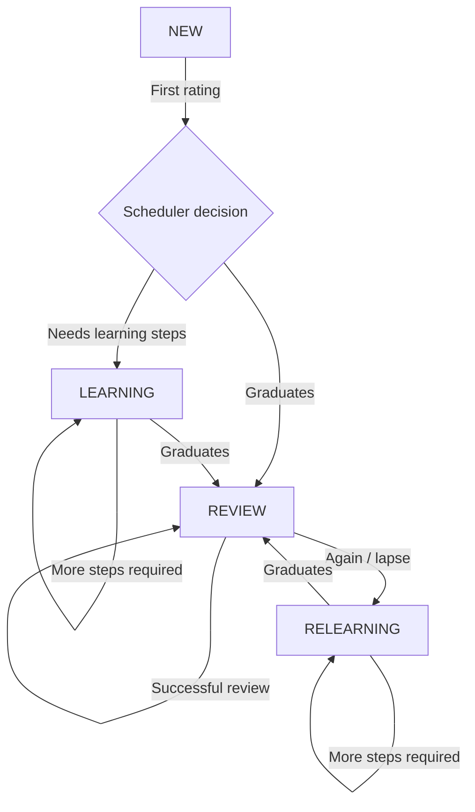
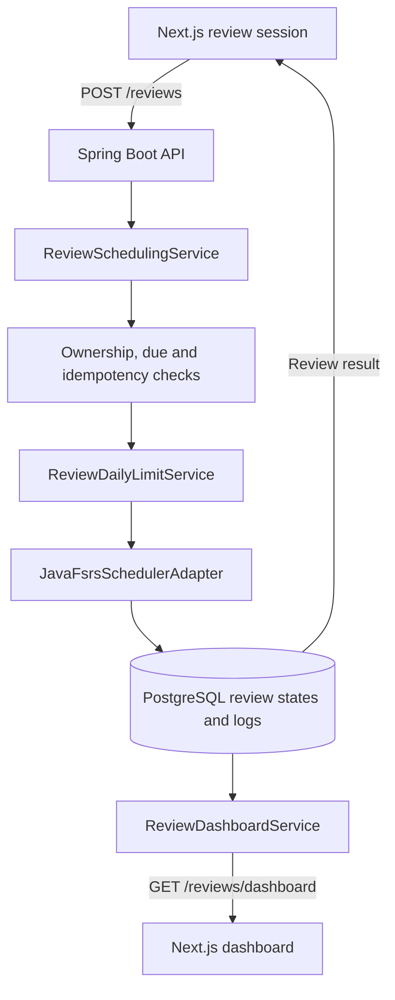

# FSRS-6: Algorithm and Brain Booster Integration

> Technical documentation for Brain Booster's spaced repetition feature. This document distinguishes the **FSRS-6 memory model** from the **application-specific scheduling, persistence, limits, and analytics** implemented in Brain Booster.
>
> [Back to the project README](../README.md)

## Contents

1. [Why spaced repetition?](#1-why-spaced-repetition)
2. [How FSRS models memory](#2-how-fsrs-models-memory)
3. [The FSRS-6 forgetting curve](#3-the-fsrs-6-forgetting-curve)
4. [How a rating changes the schedule](#4-how-a-rating-changes-the-schedule)
5. [The four learning stages](#5-the-four-learning-stages)
6. [What is special about FSRS-6?](#6-what-is-special-about-fsrs-6)
7. [Worked examples](#7-worked-examples)
8. [Architecture in Brain Booster](#8-architecture-in-brain-booster)
9. [Data model and persistence](#9-data-model-and-persistence)
10. [API and review workflow](#10-api-and-review-workflow)
11. [Settings and daily limits](#11-settings-and-daily-limits)
12. [Dashboard and analytics](#12-dashboard-and-analytics)
13. [Concurrency, idempotency, and consistency](#13-concurrency-idempotency-and-consistency)
14. [Scope and current limitations](#14-scope-and-current-limitations)
15. [Testing and verification](#15-testing-and-verification)
16. [References](#16-references)

---

## 1. Why spaced repetition?

A flashcard does not need to be reviewed at the same fixed interval as every other flashcard. Easy material can usually wait longer, while difficult or forgotten material should return sooner.

**Spaced repetition** schedules review sessions over time instead of showing every card every day. **FSRS** (*Free Spaced Repetition Scheduler*) is an adaptive scheduling algorithm based on a mathematical model of memory. It uses review outcomes and elapsed time to estimate how likely a card is to be remembered and when it should be shown again.

For Brain Booster, this is an additional study mode:

- **Classic flashcards:** users flip cards and track known/unknown progress locally.
- **Learning games:** attempts and individual answers produce scores, accuracy, and weak-card analytics.
- **FSRS reviews:** a separate, persistent review history controls future due dates.

**Important:** Brain Booster does not infer FSRS ratings from game scores. A flashcard's FSRS schedule changes when the user submits an FSRS review rating.

## 2. How FSRS models memory

FSRS is commonly explained using three quantities, known as the **DSR model**.

| Symbol | Name | Meaning |
| --- | --- | --- |
| **D** | Difficulty | Relative difficulty of remembering a card, typically represented on a 1–10 scale. |
| **S** | Stability | How long it takes for the modeled probability of recalling the card to fall to **90%**. Its time scale is days. |
| **R** | Retrievability | Estimated probability, between 0 and 1, that the answer can be recalled **right now**. |

### Difficulty (D)

Difficulty is **not** the number of times a card was answered incorrectly and is not the same as accuracy in a learning game. It is a model variable updated based on the card's review history and ratings.

### Stability (S)

Stability describes the estimated durability of the memory. If `S = 10 days`, then the forgetting-curve model predicts about a 90% chance of recall **10 days after the previous review**.

It does **not** mean that the next review must occur in exactly 10 days: the desired retention, learning steps, scheduling restrictions, and scheduler configuration can change the actual due date.

### Retrievability (R)

Retrievability is **time-dependent**. Without a review, the predicted probability of recall decreases as time passes. A successful review generally strengthens the memory state, which may allow a longer interval next time.

### Model state versus scheduling state

The mathematical model uses `D`, `S`, and the implied `R`. A real scheduler also needs operational information, such as:

- whether a card is new, learning, in long-term review, or relearning;
- the next due instant;
- the last review time;
- the current short-term learning step.

Brain Booster keeps this information in the serialized Java-FSRS `Card` object.

## 3. The FSRS-6 forgetting curve

The FSRS-6 model uses a forgetting curve with a **trainable decay parameter**, rather than assuming a single fixed shape for everyone.

Let:

- `t` = elapsed time since the previous review, in days;
- `S` = current memory stability, in days;
- `d = w_20 > 0` = the decay parameter;
- `F = 0.9^(-1/d) - 1` = a factor that normalizes the model.

Then:

$$
R(t,S) = \left(1 + F\frac{t}{S}\right)^{-d}
$$

The factor is chosen so that:

$$
R(S,S) = 0.9
$$

In other words, **stability always corresponds to the modeled 90% recall point**.

### From desired retention to the next interval

If the target recall probability is `r` (for example, `0.90`), the theoretical interval can be obtained by solving the curve for time:

$$
I(r,S) = \frac{S}{F}\left(r^{-1/d}-1\right)
$$

This gives the basic relationship:

- **Higher desired retention** (e.g., 95%) → shorter interval, generally more reviews.
- **Lower desired retention** (e.g., 80%) → longer interval, generally fewer reviews.
- **At 90% retention** → the theoretical interval equals stability `S`.

This formula explains the *memory model*. The exact `dueAt` returned by Java-FSRS also depends on the library's state machine, learning/relearning steps, interval rounding, possible interval fuzzing, and configuration. **Do not calculate production due dates by reimplementing this formula in Brain Booster.** The Java-FSRS scheduler remains authoritative.

## 4. How a rating changes the schedule

The user first tries to recall the answer, reveals the flashcard, and chooses one of four ratings.

| UI rating | Internal rating | Meaning | Typical effect |
| --- | --- | --- | --- |
| **Again** | `AGAIN` (`G = 1`) | Could not recall the answer | Moves into, or continues, short-term learning/relearning and typically schedules a near-term step. |
| **Hard** | `HARD` (`G = 2`) | Recalled with significant difficulty | Usually produces a shorter interval than Good. |
| **Good** | `GOOD` (`G = 3`) | Recalled with normal effort | Standard successful-review outcome. |
| **Easy** | `EASY` (`G = 4`) | Recalled easily | Usually results in a longer interval and can graduate a new card sooner. |

These are *user-reported review outcomes*, not automated correctness checks. Exact state transitions and delays are computed by the scheduler, not hard-coded from the table above.

For each accepted rating, the model conceptually:

1. Restores the previous memory state.
2. Determines elapsed time and predicted retrievability.
3. Updates difficulty and stability using the chosen rating and FSRS parameters.
4. Determines the new learning stage and next due time.
5. Produces an updated card and a review event.

### Initial difficulty and stability

FSRS-6 uses **21 model weights**, commonly written as `w_0` through `w_20`.

The first rating initializes stability and difficulty. In the abstract FSRS-6 model, the initial values follow formulas such as:

$$
S_0(G) = \operatorname{clamp}(w_{G-1}, S_{min}, S_{max})
$$

$$
D_0(G) = \operatorname{clamp}\left(w_4 - e^{w_5(G-1)} + 1,\;1,\;10\right)
$$

`clamp` means keeping a result inside the allowed range. These equations describe the mathematical model, while the actual scheduling step remains managed by Java-FSRS.

### Difficulty after subsequent reviews

The model updates difficulty according to the rating, with damping and mean reversion. In simplified notation:

$$
\Delta D = -w_6(G-3)
$$

$$
D^* = D + \Delta D\frac{10-D}{9}
$$

$$
D' = \operatorname{clamp}\left(w_7D_0(4) + (1-w_7)D^*,\;1,\;10\right)
$$

This helps avoid difficulty drifting indefinitely based on a few ratings. Full stability-update equations depend on elapsed time, the rating, and the selected FSRS version; see the [official FSRS-6 mathematical documentation](https://open-spaced-repetition.github.io/ts-fsrs/guide/model/fsrs-6).

## 5. The four learning stages

Brain Booster uses the stages exposed by Java-FSRS:

| Stage | Purpose | Meaning in Brain Booster |
| --- | --- | --- |
| `NEW` | Not yet introduced | No successful FSRS learning history is needed to offer the card as new. |
| `LEARNING` | Short-term learning steps | The card is being learned and may return after minutes. |
| `REVIEW` | Long-term spaced repetition | The scheduler uses the established memory state to space future reviews. |
| `RELEARNING` | Recovering after forgetting | An established review card was forgotten and follows relearning steps. |

A typical lifecycle might look like this:



This is **illustrative**, not a complete specification of every Java-FSRS rating-to-stage transition. The exact transitions depend on the scheduler's learning/relearning-step configuration.

### Why learning steps matter

Learning steps are short operational intervals distinct from the long-term memory interval equation. The Java-FSRS default configuration documents minute-scale learning and relearning steps; the exact duration depends on the previous card state and rating.

A card should not lose its learning-step position after a server restart. Brain Booster therefore stores the **complete serialized `Card`**, including the step, instead of relying on a separate SQL `learning_step` column.

## 6. What is special about FSRS-6?

FSRS-6 builds on earlier FSRS models. Two notable improvements are:

1. **Trainable forgetting-curve decay:** `w_20` controls the curve shape, instead of a fixed exponent.
2. **Same-day stability modeling:** a specialized formula accounts for reviews where the model receives zero elapsed days.

For zero elapsed days, the model includes a stability multiplier of the form:

$$
S_{inc} = S^{-w_{19}}e^{w_{17}(G-3+w_{18})}
$$

The implementation applies additional rules and bounds. In particular, these formulas do **not** mean that every interaction in the same local calendar date necessarily uses the same computation: the model depends on how the scheduler represents elapsed days.

### Model weights are not the same as desired retention

The **21 FSRS parameters** describe how the memory model responds to elapsed time and ratings. **Desired retention** is a *scheduling target* used to choose the next review interval from the model.

Brain Booster currently supports changing desired retention but **does not train or optimize the 21 weights for each user**. A nullable `fsrs_parameters` column exists in `user_review_settings`, but the current scheduler integration does not apply user-specific optimized parameters. Java-FSRS itself does not provide a built-in parameter optimizer.

## 7. Worked examples

These examples explain the workflow rather than promise exact scheduler intervals.

### Example A: First encounter with a card

1. A user starts a review of a `NEW` card.
2. They reveal the answer and choose `GOOD`.
3. The backend passes the rating, existing card data (if any), desired retention, and the review timestamp to Java-FSRS.
4. The scheduler returns an updated card state, possibly still in `LEARNING`, with its next due instant.
5. Brain Booster saves the state and an immutable event with `stage_before = NEW`.

### Example B: A short-term learning step

1. The same card becomes due while its stage is `LEARNING`.
2. The user rates it again.
3. Java-FSRS advances, repeats, or finishes the relevant learning step based on the rating and card state.
4. Brain Booster records the updated due time and stage.

This rating does not consume the regular `REVIEW` daily budget. It also does not introduce a second new card.

### Example C: Forgetting an established card

1. A card in `REVIEW` becomes due.
2. The user chooses `AGAIN`.
3. Java-FSRS updates its memory state and may move it into `RELEARNING`.
4. Brain Booster increments `lapses` because the **previous** stage was `REVIEW` and the rating was `AGAIN`.
5. The following relearning steps remain available even if a daily limit has been reached.

### Example D: Desired retention

Suppose the model assigns stability `S = 10 days` and the desired retention is `r = 0.90`. The theoretical interval derived from the forgetting curve is 10 days because `R(S,S) = 0.90`.

Changing the target to `0.95` makes the theoretical interval shorter, and changing it to `0.80` makes it longer. This is **not a promise that the Java-FSRS scheduler will return those exact intervals** for a particular card, especially during learning steps.

## 8. Architecture in Brain Booster

**Backend:** Java 25, Spring Boot, Spring Data JPA, Java-FSRS (`io.github.open-spaced-repetition:fsrs:1.0.0`), PostgreSQL, Flyway.

**Frontend:** Next.js App Router, TypeScript, shadcn/ui, Recharts.

The main backend responsibilities are separated into:

| Component | Responsibility |
| --- | --- |
| `JavaFsrsSchedulerAdapter` / `FsrsSchedulerAdapter` | Translate Brain Booster's review inputs to Java-FSRS, restore and serialize card state, and return scheduling results. |
| `ReviewSchedulingService` | Validate and record a rating, enforce ownership/idempotency/due checks, call FSRS, and persist state plus history atomically. |
| `ReviewSessionService` | Build an eligible queue for a user-owned flashcard set. |
| `ReviewDailyLimitService` | Calculate and enforce daily capacity based on history and the user's local day. |
| `UserReviewSettingsService` | Read or update retention, daily limits, and time zone. |
| `ReviewDashboardService` | Aggregate review states, activity, ratings, and upcoming due dates. |
| `CurrentUserProvider` | Resolve the authenticated user from the security context. |



The diagram depicts responsibilities, not exact call-stack or database-connection boundaries.

## 9. Data model and persistence

The original Flyway migration creates three FSRS-related tables.

### `flashcard_review_states`

Stores one **current FSRS state per user and flashcard**.

| Column | Purpose |
| --- | --- |
| `user_id`, `flashcard_id` | Identify the owner/card pair; unique together. |
| `state` | Current `NEW`, `LEARNING`, `REVIEW`, or `RELEARNING` stage. |
| `due_at` | Next scheduled review instant. |
| `last_reviewed_at` | Most recent review instant. |
| `stability`, `difficulty` | Searchable/analytical projections of the model state. |
| `fsrs_card_data` | **Full serialized Java-FSRS card; authoritative input for later reviews.** |
| `review_count`, `lapses` | Review and forgetting counters. |
| `algorithm_version` | Recorded model identifier, `FSRS-6`. |
| `version` | JPA optimistic-lock version field. |

The complete `Card` JSON stores information such as stage, step, due time, and memory variables. `scheduled_days` and `learning_step` are **not** stored as separate columns in the current table definition; the scheduler obtains the required state from `fsrs_card_data`.

A missing state record means the flashcard has not yet been introduced to this user's FSRS workflow. The queue and dashboard can still count it as `NEW`.

### `flashcard_review_logs`

Stores an **append-only history of accepted ratings** (until the associated state is deleted):

- `rating`, `reviewed_at`;
- `stage_before`, `stage_after`;
- `previous_due_at`, `next_due_at`;
- `card_data_before`, `card_data_after`;
- `algorithm_version`, unique UUID `request_id`.

An immutable event is essential for auditability, activity charts, daily usage, and idempotent retries. The foreign key uses `ON DELETE CASCADE` from the state, so deleting a state also deletes its history; this is not a permanent audit log independent of card deletion.

### `user_review_settings`

Stores one row per user when settings have been saved:

| Setting | Default | Exposed in the UI? |
| --- | --- | --- |
| `desired_retention` | `0.90` | Yes, 70%–97%. |
| `new_cards_per_day` | `20` | Yes. |
| `review_limit_per_day` | `200` | Yes. |
| `timezone` | `UTC` | Detected automatically, not manually selected. |
| `fsrs_parameters` | `NULL` | No; user-specific optimizer not implemented. |
| `algorithm_version` | `FSRS-6` | No. |

If no row exists, the backend returns effective defaults. Saving the settings creates or updates the row.

## 10. API and review workflow

The backend API is served under `/api/v1`. Endpoints below are relative to that base path.

| Method | Path | Purpose |
| --- | --- | --- |
| `GET` | `/reviews/sets/{setId}/queue` | Fetch due and eligible new cards for a set owned by the current user. |
| `POST` | `/reviews` | Submit a rating and record its updated schedule. |
| `GET` | `/reviews/settings` | Retrieve saved or default settings. |
| `PATCH` | `/reviews/settings` | Partially update review preferences. |
| `GET` | `/reviews/dashboard` | Retrieve aggregated FSRS statistics for the authenticated user. |

### Example review request

```http
POST /api/v1/reviews
Authorization: Bearer <JWT>
Content-Type: application/json
```

```json
{
  "flashcardId": 42,
  "rating": "GOOD",
  "requestId": "e51773b7-a113-446b-9efd-b257e3301990"
}
```

An accepted response includes the same `requestId`, the card ID, rating, resulting stage, `reviewedAt`, and `nextReviewAt`.

### Accepted review, step by step

1. Identify the authenticated user.
2. Acquire a **pessimistic lock on that user's row**, serializing review submissions for the same user.
3. Check whether `requestId` already exists. If it matches the original user, flashcard, and rating, return the existing result without changing the schedule again.
4. Verify ownership of the flashcard and whether a card with a recorded state is actually due.
5. Determine the card's **stage before the review** and verify available daily capacity.
6. Restore `Card` using its serialized JSON, or initialize a new card for a first-time review.
7. Invoke the Java-FSRS adapter using a **single explicit `Instant`** for this review and the configured desired retention.
8. Save the new serialized card state and an immutable review log in one database transaction.
9. Return the updated stage and next review timestamp.

Conceptually, the adapter is called with:

```java
FsrsReviewResult result = fsrsSchedulerAdapter.review(
        previousCardData,
        request.rating(),
        desiredRetention,
        currentTime
);
```

**The application delegates FSRS mathematics to Java-FSRS**. It does not separately approximate intervals or try to reconstruct the full card from only `stability`/`difficulty` columns.

### API error behavior

A new request for a card that is not due, exceeds a daily limit, or conflicts with an already-used UUID is rejected rather than silently altering the schedule. The review-session frontend handles the resulting conflict and preserves the request UUID for safe retries of the *same* submission.

## 11. Settings and daily limits

### Desired retention

The setting ranges from **70% to 97%**, with a default of **90%**. It affects **future scheduling calculations**, not previously stored due dates. Changing the value does not retroactively reschedule every existing card.

### Daily limit policy

Brain Booster uses the card's **stage before the rating** to decide which limit applies:

| Stage before rating | Capacity consumed |
| --- | --- |
| `NEW` | One new-card slot. |
| `REVIEW` | One regular-review slot. |
| `LEARNING` | None — the short-term sequence can continue. |
| `RELEARNING` | None — the relearning sequence can continue. |

This distinction is intentional: reaching the new-card limit should not prevent someone from completing a learning step on a card that was already introduced.

Limits are **per user across all sets**, not per set. They are checked both while preparing a queue and when accepting a review. The submission-side check is authoritative: a previously fetched queue does not reserve capacity indefinitely.

### Time zones

The memory scheduler works with **absolute timestamps** (`Instant`, persisted as PostgreSQL `TIMESTAMPTZ`). A user's local time zone is only used to define calendar-day boundaries for daily counts and dashboard charts.

For example, `Europe/Warsaw` means the daily budget resets at local midnight, including daylight-saving-time transitions. A local day may be 23, 24, or 25 hours; the implementation converts the start of each local calendar day to UTC instants rather than assuming a fixed 24-hour window.

The browser discovers the IANA zone via:

```typescript
Intl.DateTimeFormat().resolvedOptions().timeZone
```

The detected zone is synchronized to the backend **when the settings are saved**. Until then, an account without saved settings uses `UTC`.

## 12. Dashboard and analytics

The dashboard route is `/reviews/dashboard`. It summarizes **the authenticated user's cards across all owned sets**.

| Metric | What it measures |
| --- | --- |
| `totalCards` | Number of owned flashcards. |
| `newCards` | Cards not yet introduced to FSRS, including cards without a state row. |
| `learningCards` | Cards currently in `LEARNING`. |
| `reviewCards` | Cards currently in `REVIEW`. |
| `relearningCards` | Cards currently in `RELEARNING`. |
| `dueNow` | Scheduled cards already due, including overdue cards. |
| `reviewedToday` | Review-log events on the current local day. |
| `activity` | Ratings and new-card introductions during the last 14 local days. |
| `ratings` | Counts of Again/Hard/Good/Easy ratings during that 14-day period. |
| `forecast` | Current overdue/due cards and upcoming scheduled due dates across seven local days. |

### Interpreting the charts

- **Review activity:** `newCards` is a subset of total ratings; the two series should not be added together to derive total activity.
- **Due now versus today's forecast:** `dueNow` may be zero even when cards are scheduled **later today**. The first forecast day includes those future-today cards as well as cards already due.
- **Forecast is not a promise:** reviewing cards again changes their schedules, so the future chart changes over time.
- **Stage is not mastery:** `REVIEW` identifies an FSRS scheduling stage; it is not equivalent to 100% accuracy or permanent mastery.
- **Limits do not rewrite due dates:** a card can remain overdue when the daily review budget is exhausted.

## 13. Concurrency, idempotency, and consistency

### Idempotency with `requestId`

A user may click a rating button and lose the network response. Repeating the **same request with the same UUID** must not schedule the card twice.

Brain Booster checks `flashcard_review_logs.request_id` within the review transaction:

- Same UUID + same user + same card + same rating → return original result.
- Same UUID used for different review data → reject as a conflict.

A unique database constraint on `request_id` is a further safety boundary.

### Pessimistic user-row lock

The service locks the user row **before** reading the review and daily-usage state. This serializes submissions by the same user, including requests for different cards. Two independent requests cannot both assume the same remaining daily slot after the first one has committed.

### Atomic persistence

A successful review changes the current FSRS card state and writes a review log **inside one transaction**. If it fails, neither the new state nor the history event should be committed. Database timestamps are normalized to PostgreSQL microsecond precision for consistent persisted and retried results.

### Consistency across models

- `fsrs_card_data` is authoritative for **future scheduling**.
- `state`, `due_at`, `stability`, and `difficulty` are query-friendly projections of that state.
- `flashcard_review_logs` is authoritative for **past review events and daily counters**.
- The dashboard and queue query data for the current authenticated user, never a user ID supplied by the browser.

## 14. Scope and current limitations

The current implementation provides a working FSRS-6 learning workflow, but does not attempt to implement everything possible in the wider FSRS ecosystem.

**Implemented:**

- Java-FSRS-based card scheduling with preserved state;
- four review ratings and lifecycle stages;
- owner-only FSRS study sessions;
- PostgreSQL persistence and review history;
- idempotent, transactionally safe submissions;
- configurable target retention and daily limits;
- local-day behavior using user time zones;
- dashboard, activity, rating distribution, and due forecast.

**Not implemented (possible future work):**

- per-user optimization of the 21 FSRS weights from accumulated review history;
- a UI for editing raw FSRS parameters;
- immediate recalculation of every existing `dueAt` when retention changes;
- pre-rating interval previews for all four buttons;
- forecasts of actual future workload that account for future user choices and card introductions.

The `fsrs_parameters` database field is **not evidence that parameter optimization is active**. If optimization is added, its training, validation, versioning, and deployment should be designed and tested separately.

## 15. Testing and verification

The backend uses JUnit and PostgreSQL Testcontainers. The FSRS-related tests cover scheduling integration, persistence of card state and logs, request idempotency, ownership, daily limit rules, local-day boundaries, and concurrent submissions.

From the backend directory:

```bash
./gradlew clean test
```

On Windows:

```powershell
.\gradlew.bat clean test
```

Frontend verification uses TypeScript, linting, a production build, and manual checks:

```bash
pnpm exec tsc --noEmit
pnpm lint
pnpm build
```

Recommended manual scenarios include:

1. Review a new card, reload the page, and confirm that its FSRS state persists.
2. Re-send an accepted review using the same UUID and verify no duplicate log is created.
3. Set a new-card limit, exhaust it, and verify that the next new card cannot be reviewed.
4. Verify that due `LEARNING` and `RELEARNING` steps still work when ordinary daily limits are exhausted.
5. Save the browser-detected time zone and confirm it is displayed in the dashboard.
6. Review cards and refresh the dashboard to observe updated activity and scheduling.

## 16. References

For the general FSRS-6 mathematics and Java-FSRS library behavior, consult the project-maintained sources:

- [Open Spaced Repetition — The Algorithm (including FSRS-6)](https://github.com/open-spaced-repetition/awesome-fsrs/wiki/The-Algorithm)
- [FSRS-6 mathematical model and equations](https://open-spaced-repetition.github.io/ts-fsrs/guide/model/fsrs-6)
- [Java-FSRS repository, scheduler configuration, and serialization](https://github.com/open-spaced-repetition/java-fsrs)

These references describe the **algorithm or library in general**. The API behavior, database schema, locking policy, daily limits, and dashboard described above are **Brain Booster implementation choices**.
